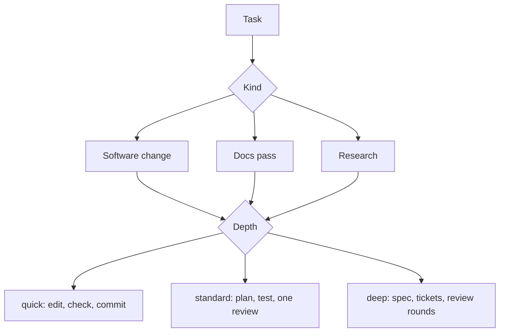
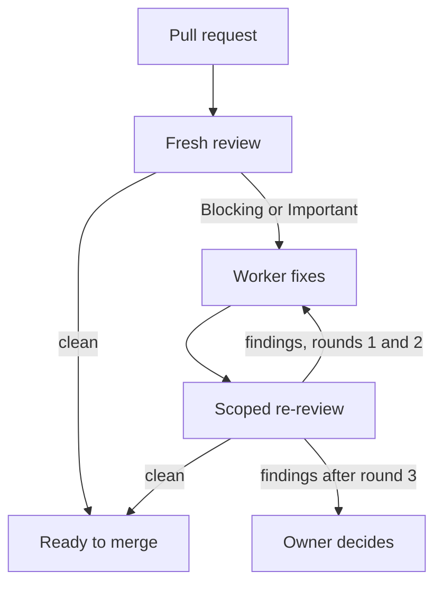

# Concepts

## Workflows and depth

Before the first edit, the `workflow` skill sorts the task by kind and gives it a depth. It writes the pick as a line you can check, such as `Depth: standard (bug)`.

| Depth | When |
|---|---|
| quick | the diff fits in one sentence |
| standard | one behavior, or a bug |
| deep | several behaviors, a new capability, an uncertain approach, or a risky change |

A risky change (authentication, permissions, secrets, input validation, production data, deploy configuration, anything irreversible) always runs deep. Unsure between two depths? The deeper one wins.

To fix the kind, type `/cl-workflow:dev` or `/cl-workflow:research`. `/cl-workflow:full` runs a deep change, and `/cl-workflow:plan` settles a task with you before any code.

## Phases

At standard and deep depth, the session orchestrates the phases of the change. A phase agent is a fresh subagent with its own tools and effort:

- **plan**, **plan check**, **implement**, **test** and **review** build the change.
- **verify** checks review findings, a plan or a research answer before it is used.
- **recheck** re-reviews a fix against the earlier findings.
- **gather** runs read-only lookups.

A routine standard change (not risky, and not touching CI, data formats, guards or money) runs plan and implement in the session itself; plan check, test and review stay subagents. Every other change runs every phase as a subagent.

The task ends with a report that names each check's command and result, and the steps it skipped.

## Roles and bots

| Role | Does |
|---|---|
| Owner | chooses the work; owns releases, settings, secrets and every merge the policy does not allow |
| Coordinator | picks labeled issues, starts workers, has each pull request reviewed, merges by the policy |
| Worker | an issue, or a small batch, in its own worktree, by the workflow at its depth |
| Reviewer | a fresh session per pull request; also re-reviews fixes |

The role guard, a hook of `cl-workflow`, refuses merges, releases, tag pushes and pushes to the default branch in every subagent and every session but the coordinator's. It is a hook, not a boundary: branch rulesets and a token without those rights stay binding.

A repository run by bots maps the same roles to a project bot and role bots (planner, reviewer, maintainer, fixer, worker). Each bot is refused what its procedure does not need.

## Questions and away mode

The agent may ask you while you are here. Run `/cl-workflow:away` when you leave (`/cl-workflow:away 2h` for a span). A hook then refuses the question tool and plan mode: the agent takes each safe, reversible recommendation, files the other questions with its recommendations, and keeps working.

`/cl-workflow:away off` brings you back and asks up to 5 queued owner questions. The coordinator files its questions as `cl:needs-human` issues, or in a local queue when the repository has issues off.

## The review loop

Every pull request gets a fresh reviewer. A sensitive change (CI, guards, data formats, money, agent instructions) gets a deeper review plus a security review.

Round 3 runs the fix on a stronger model. Minor findings are listed, not fixed.

Details: [the plugins](https://github.com/CedarLoom/cedarloom/blob/main/docs/plugins.md), [the workflow skill](https://github.com/CedarLoom/cedarloom/blob/main/plugins/cl-workflow/skills/workflow/SKILL.md), [review and merge](https://github.com/CedarLoom/cedarloom/blob/main/plugins/cl-orchestration/skills/coordinate/review-and-merge.md).
