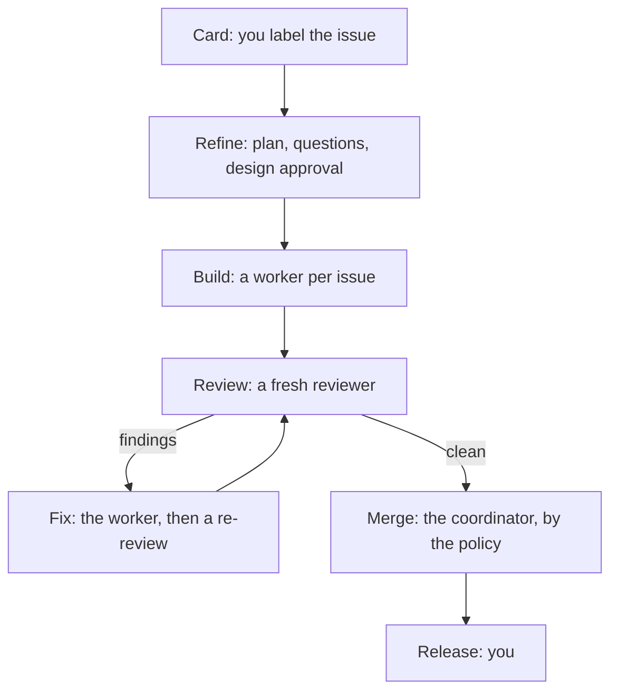
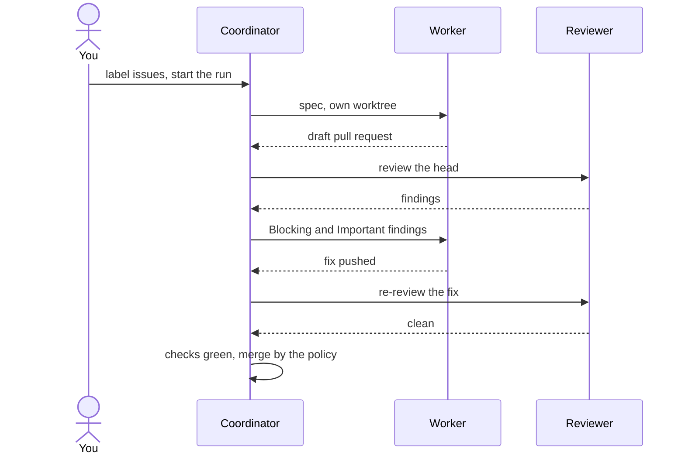

# Lifecycle

With `cl-orchestration`, the coordinator moves an issue from card to merge. You choose the work, answer the questions it raises, and release.

## Card

An issue is the unit of work. Label it `cl:plan` to let CedarLoom read, plan and ask on it without starting work, or `cl:ready-for-agent` to let the coordinator start it. The coordinator starts nothing until the repository's policy file, written by `/cl-repo:setup`, is on the default branch. An issue whose result cannot be stated as a check is listed for you, not started.

## Refine

Refining settles the goal, scope, depth and risk, the steps and an acceptance table. `/cl-workflow:plan` does it with you before the issue starts; otherwise the worker's plan phase does it at standard and deep depth. Deep or high-risk work waits for your approval of its design before a worker starts. Questions reach you as `cl:needs-human` issues; an answered one gets `cl:ready-for-agent`.

## Build to merge

**Build.** The coordinator writes a spec per issue and starts its worker through Orca, within the policy's worker limits. The `cl:in-progress` label keeps an issue from starting twice. The worker runs the workflow at the spec's depth, and its change becomes a draft pull request.

**Review.** A fresh reviewer checks the head. The coordinator posts the verdict as the review of record.

**Fix.** Blocking and Important findings go back to the worker, one follow-up per round, and each fix gets a scoped re-review. Findings left after round 3 come to you.

**Merge.** The draft turns ready when the last review is clean, the required checks are green and no review thread is open. The coordinator merges only where the policy's `merge.allowed` is set and only up to `merge.autoMergeMax` (medium by default; high risk is always yours). A pull request with an owner-only file stays open for you.

## Release

Releases and tags are yours. No worker creates one, and the coordinator leaves a release pull request to you.

Details: [the coordinator](https://github.com/CedarLoom/cedarloom/blob/main/plugins/cl-orchestration/skills/coordinate/SKILL.md), [policy fields](https://github.com/CedarLoom/cedarloom/blob/main/plugins/cl-orchestration/skills/coordinate/policy.md), [owner questions and labels](https://github.com/CedarLoom/cedarloom/blob/main/docs/plugins.md#owner-questions).
